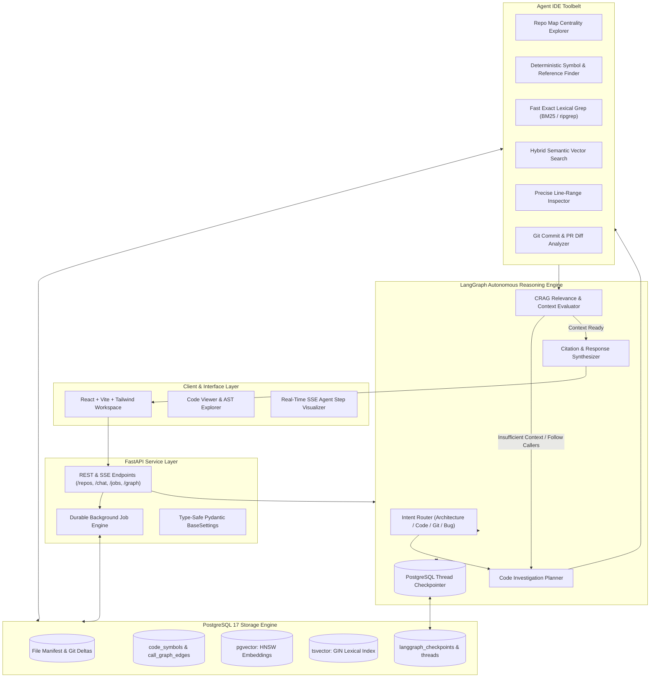
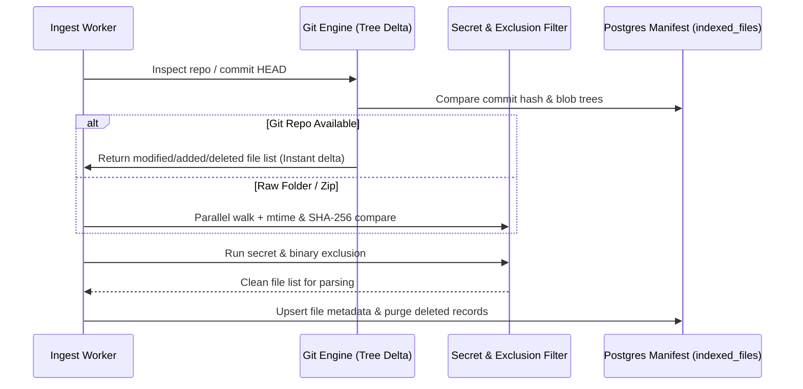
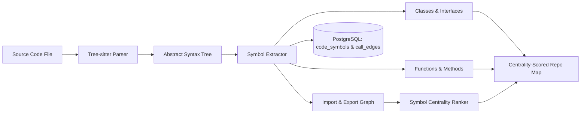
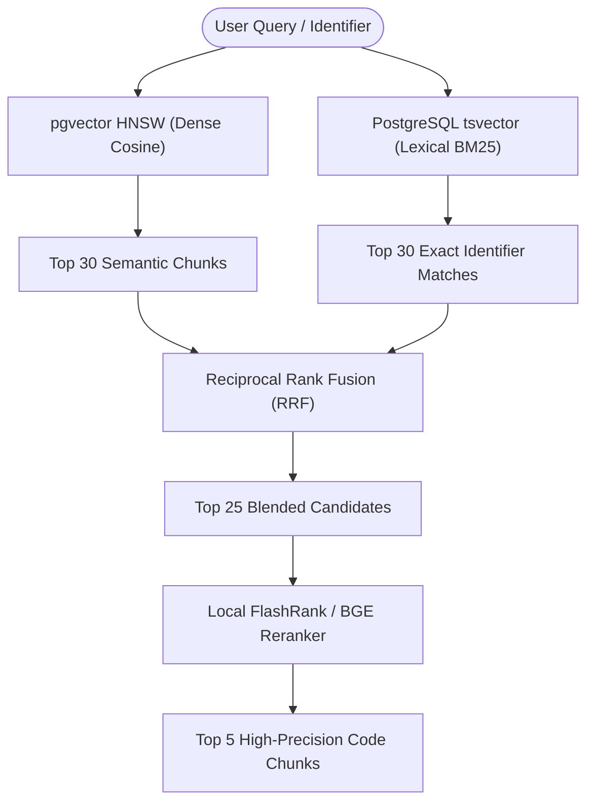
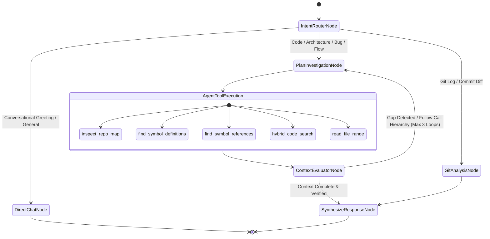
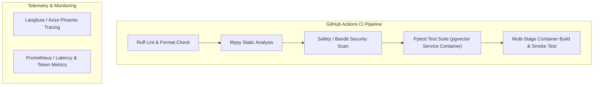

# Agentic-Code-RAG: Next-Generation Autonomous Code Intelligence Engine
## Production Architecture & Staged Implementation Roadmap

---

## 1. Executive Vision: The "Agent-as-an-IDE" Paradigm

Traditional Code RAG pipelines treat codebases like collections of text documents: they slice files into arbitrary 50-line chunks, embed them into high-dimensional space, and perform a naive top-K similarity search. **This approach fails on real-world software engineering tasks** because code is not prose—it is a tightly coupled, highly structured graph of dependencies, type definitions, function calls, and control flows.

**Agentic-Code-RAG** discards the naive document paradigm and adopts an **"Agent-as-an-IDE" Architecture**:
1. **Hierarchical Repo Map (PageRank over AST Symbols):** A global, compressed structural map of the repository (classes, functions, signatures) weighted by centrality, allowing the agent to grasp repo-level architecture within minimal tokens.
2. **Deterministic Symbol & Reference Indexing:** Precise Tree-sitter AST extraction that indexes definitions, references, imports, and call hierarchies. When asking about a function, the agent navigates definitions and callers with 100% precision, not vector guesswork.
3. **Hybrid Code Retrieval (pgvector + BM25 tsvector + FlashRank):** Dense semantic search combined with PostgreSQL lexical full-text search using Reciprocal Rank Fusion (RRF) and fast cross-encoder reranking.
4. **Autonomous Multi-Hop Reasoning via LangGraph:** The LLM acts as an autonomous engineer inside the codebase. It formulates an investigation plan, invokes tools (`inspect_repo_map`, `find_definitions`, `find_references`, `ripgrep`, `read_code_span`, `git_diff`), self-corrects missing context, and synthesizes answers with exact file and line citations.
5. **PostgreSQL 17 Unified Storage:** Vector embeddings, lexical indexes, symbol call graphs, and LangGraph thread checkpoints all reside within a single transactional engine.



---

## 2. Staged Implementation Plan

The development is divided into **8 isolated, progressive stages**. Each stage includes specific **Research & Innovation Checkpoints** to evaluate and benchmark modern approaches before implementation.

---

### Stage 0: Repository Scaffold & Engineering Lifecycle Foundation
> **Goal:** Create the new `agentic-code-rag` repository with strict enterprise-grade tooling, type checking, automated linting, containerization, and reproducible environment management.

#### Tasks:
1. **Repository Setup:** Initialize the standalone repository `agentic-code-rag` with clean modular directory layout.
2. **Modern Package Management:** Configure Python 3.12+ with `pyproject.toml` and `uv` for sub-second, deterministic dependency resolution.
3. **Centralized Configuration:** Build `src/core/config.py` using `pydantic-settings` with strict runtime validation for PostgreSQL connection strings, LLM credentials (Groq, Gemini, Ollama), and indexing thresholds.
4. **Code Quality & Git Hooks:**
   - Configure **Ruff** (linting + automated formatting).
   - Configure **Mypy** with strict static type checking.
   - Set up `.pre-commit-config.yaml` to prevent committing unformatted code or credentials.
5. **Developer DX & Task Runner:** Implement a standardized `Makefile` (`make dev`, `make test`, `make lint`, `make docker-up`).
6. **Container Environment:** Create multi-stage `Dockerfile` and `docker-compose.yml` orchestrating PostgreSQL 17 with `pgvector`.

> [!TIP]
> **Research Checkpoint 0:** Validate `uv` vs `poetry`. `uv` provides native C-extension caching, sub-second installs, and built-in Python tool management without requiring virtualenv activation rituals.

#### Deliverables:
- Working `docker-compose.yml` spinning up PostgreSQL 17 with `pgvector`.
- Validated `src/core/config.py` passing runtime configuration tests.
- Zero-error baseline across `ruff check` and `mypy src`.

---

### Stage 1: Git-Native Ingestion & Change Detection Engine
> **Goal:** Build a lightning-fast, git-aware ingestion engine that leverages Git commit deltas and file hashes to index codebases incrementally without re-crawling unchanged files.



#### Tasks:
1. **Git-Native Delta Detection:** For Git repositories, inspect `git diff-tree` between current commit HEAD and the last-indexed commit. Detect newly modified and deleted files in milliseconds instead of traversing millions of lines.
2. **Universal Source Support:** Seamless support for local directories, remote Git URLs (cloned into isolated scratch areas), and uploaded ZIP archives.
3. **Advanced Security Filtering:**
   - Multi-layered `.gitignore` evaluation via `pathspec`.
   - Security sanitizer blacklisting `.env*`, `.pem`, `.key`, `id_rsa`, `.crt`, `.secret`, and token patterns.
   - Enforce hard binary and minified file detection (skipping `.min.js`, bundle maps, binaries).
4. **Relational Manifest Storage:** PostgreSQL table `indexed_files` tracking `file_path`, `blob_hash`, `mtime`, `commit_sha`, `language`, `size_bytes`, and `status`.

> [!TIP]
> **Research Checkpoint 1:** Compare `pygit2` (libgit2 bindings) vs `GitPython`. `pygit2` operates directly on Git object databases in C, yielding 10x faster commit tree diffing.

#### Deliverables:
- Ingestion engine in `src/ingest/` with full unit test coverage.
- Secret sanitization tests proving sensitive environment files are excluded.
- Instant incremental indexing verification (detecting 1 modified file in a 5,000-file repository in < 100ms).

---

### Stage 2: Tree-sitter Symbol Extraction & Centrality Repo Map
> **Goal:** Go beyond flat text chunking. Extract an AST code property graph (classes, functions, method signatures, docstrings) and generate a centrality-ranked Repository Map.



#### Tasks:
1. **Tree-sitter Multi-Language Grammars:** Support Python, TypeScript, JavaScript, Go, Rust, Java, C++, and C#.
2. **AST Symbol Extractor:**
   - Extract `SymbolRecord`: `name`, `qualified_name`, `kind` (`class`, `function`, `interface`, `method`, `variable`), `signature`, `docstring`, `start_line`, `end_line`.
   - Extract relational edges: `IMPORTS`, `EXPORTS`, `CALLS`, `INHERITS`.
3. **Centrality-Scored Repository Map (PageRank over Symbols):**
   - Build an in-memory graph of all symbol definitions and references.
   - Compute PageRank centrality scores to identify the most critical core interfaces and helper modules.
   - Generate a concise, token-budgeted ASCII/markdown structural outline of the repo that can be injected into the LLM context.
4. **Relational Graph Schema in PostgreSQL:**
   - `code_symbols`: Storing symbol signatures, docstrings, line numbers, and language.
   - `symbol_edges`: Directed caller/callee relations for instant graph traversal.

> [!TIP]
> **Research Checkpoint 2:** Explore Aider's Repo Map algorithm. By weighting symbols with PageRank and fitting them into a 1,024-token budget, the LLM understands the global architecture before issuing a single tool call.

#### Deliverables:
- AST extractor `src/parser/ast_extractor.py` and graph generator `src/parser/repo_map.py`.
- Unit tests verifying symbol and reference extraction across Python and TypeScript.
- PostgreSQL migrations for `code_symbols` and `symbol_edges`.

---

### Stage 3: Hybrid Retrieval Engine (pgvector + BM25 tsvector + FlashRank)
> **Goal:** Overcome vector search blind spots by blending dense semantic vectors with PostgreSQL exact lexical search (tsvector) using Reciprocal Rank Fusion (RRF) and local cross-encoder reranking.



#### Tasks:
1. **Dense Vector Store:** Configure `pgvector` with HNSW indexing (`vector_cosine_ops`, `m=16`, `ef_construction=64`) storing AST-aware symbol and text embeddings.
2. **PostgreSQL Lexical Full-Text Search:**
   - Add a generated `tsvector` column on code snippets using a code-optimized dictionary preserving camelCase, snake_case, and dotted package paths.
   - Create a `GIN` index for sub-millisecond keyword matching.
3. **Reciprocal Rank Fusion (RRF):** Implement rank fusion:
   $$RRF\_Score(d) = \frac{1}{60 + rank_{dense}(d)} + \frac{1}{60 + rank_{sparse}(d)}$$
4. **Local Fast Reranking:**
   - Integrate **FlashRank** or **FastEmbed Reranker** (`bge-reranker-small`).
   - Rerank the top 25 RRF candidates down to the top 5–7 highest scoring snippets.
   - Drastically cuts context token overhead and prevents hallucination.

> [!TIP]
> **Research Checkpoint 3:** Benchmark exact identifier queries (e.g. `get_auth_token` or `UserSessionStore`). Pure dense search typically places exact matches outside top 10; hybrid RRF brings them to rank #1.

#### Deliverables:
- Hybrid search module in `src/retrieval/hybrid_engine.py`.
- Automated retrieval accuracy benchmark comparing Dense vs Hybrid vs Hybrid+Rerank.

---

### Stage 4: LangGraph Autonomous Reasoning Engine (The Agentic Core)
> **Goal:** Implement an autonomous "Agent-as-an-IDE" state machine using LangGraph. Equip the agent with dynamic code exploration tools, self-correction loops, and PostgreSQL session checkpointing.



#### Tasks:
1. **LangGraph State Schema:** Define typed `AgentState`:
   - `messages`: Standard chat history.
   - `repo_id`: Target repository identifier.
   - `repo_map_summary`: High-level structural outline.
   - `discovered_symbols`: Set of classes/functions identified as candidates.
   - `inspected_snippets`: Exact code blocks with file paths and line ranges.
   - `iteration`: Loop guard (max 3–4 exploration iterations).
   - `context_sufficient`: Evaluator verification flag.
2. **The Agent IDE Toolbelt:**
   - `inspect_repo_map`: Returns top-level architecture and key module signatures.
   - `find_symbol_definitions(symbol_name)`: Returns exact line numbers and signature from AST table.
   - `find_symbol_references(symbol_name)`: Traces callers and usages across the repo.
   - `hybrid_code_search(query, top_k)`: Executes dense+sparse RRF code search.
   - `read_file_range(file_path, start_line, end_line)`: Inspects full implementation details.
   - `git_diff_analyzer(commit_range)`: Fetches live git commit diffs and commit summaries.
3. **Corrective RAG (CRAG) Evaluator:**
   - The evaluator node verifies if retrieved snippets contain the concrete logic needed to answer the user query.
   - If a snippet only reveals an import statement or interface without the implementation, the agent loops back to fetch the referenced definition.
4. **PostgreSQL Checkpointing:**
   - Configure `AsyncPostgresSaver` from `langgraph.checkpoint.postgres`.
   - Every thread checkpoint, message history, and tool invocation state is persisted durably to Postgres.
5. **Streaming Telemetry:**
   - Yield real-time Server-Sent Events (SSE) streaming both LLM text tokens and live tool invocation steps (e.g. *"Inspecting callers of `processPayment`..."*, *"Reading `src/services/billing.ts:30-80`..."*).

> [!TIP]
> **Research Checkpoint 4:** Utilize LangGraph v0.2's `astream_events(version="v2")` to stream both token chunks and tool status updates concurrently to the UI.

#### Deliverables:
- LangGraph agent workflow compiled in `src/agent/graph.py`.
- Tool implementations in `src/agent/tools/`.
- Integration tests validating that state transitions and multi-hop tool loops execute cleanly.

---

### Stage 5: Async Task Engine & Production REST API Layer
> **Goal:** Build a robust, non-blocking FastAPI backend managing asynchronous indexing jobs, streaming endpoints, and repository lifecycle management.

#### Tasks:
1. **Durable Job Engine:**
   - PostgreSQL table `indexing_jobs`: `job_id`, `repo_id`, `status` (`queued`, `cloning`, `scanning`, `ast_parsing`, `indexing`, `completed`, `failed`), `progress_pct`, `telemetry_logs`, `error_msg`, timestamps.
   - Real-time SSE streaming endpoint for live ingestion progress.
2. **REST API Endpoints:**
   - `POST /api/repos/init`: Initiates async repository ingestion and returns a `job_id`.
   - `GET /api/jobs/{job_id}/stream`: SSE endpoint streaming live progress to the frontend.
   - `POST /api/chat`: Streams LangGraph agent execution and token output via SSE.
   - `GET /api/repos/{repo_id}/map`: Returns the centrality-scored repository outline.
   - `GET /api/repos/{repo_id}/graph`: Returns AST nodes and edges for visual explorer.
   - `GET /api/repos/{repo_id}/file`: Fast file content viewer with line highlighting.
   - `DELETE /api/repos/{repo_id}`: Cascading deletion of repo vectors, graph edges, and sessions.
3. **Validation & Security:**
   - Pydantic v2 schemas for all payload validations.
   - Path traversal guards preventing unauthorized filesystem reads.
   - RFC 7807 Problem Details compliant error handlers.

> [!TIP]
> **Research Checkpoint 5:** Compare FastAPI `BackgroundTasks` + DB records vs an async worker queue (e.g. `ARQ` / Redis). For single-container deployments, DB-backed background tasks minimize architectural complexity while ensuring durability.

#### Deliverables:
- Clean modular routers in `src/api/routers/`.
- Comprehensive API integration tests with `httpx.AsyncClient`.

---

### Stage 6: Next-Gen IDE Workspace Interface (React + Vite + Tailwind)
> **Goal:** Construct a sleek, high-productivity developer interface featuring split-pane chat, live dependency graph explorer, syntax-highlighted code viewer, and step-by-step agent telemetry.

```
+---------------------------------------------------------------------------------------+
|  Agentic-Code-RAG                                         [Repo: my-repo v] [Settings]|
+-------------------+-----------------------------------+-------------------------------+
| REPOSITORIES      | AGENTIC CHAT WORKSPACE            | REPO INSPECTOR                |
|                   |                                   | [Graph View] [Code Viewer]    |
| > backend-service | User: How is JWT auth handled?    |                               |
|   - 1,420 files   |                                   |  (Interactive Force-Directed  |
|   - Status: Ready | Agentic Reasoning:                |   Dependency & Call Graph)    |
|                   | [v] Step 1: Read Repo Map         |                               |
| > frontend-app    | [v] Step 2: Found Symbol AuthMgr  |       (AuthMgr) ---> (JWTUtils)
|   - Status: Ready | [v] Step 3: Inspected callers     |           |                   |
|                   |                                   |           v                   |
| SESSIONS          | The authentication flow begins in |       (UserRoute)             |
| > Auth flow debug | src/auth/jwt.py:42:               |                               |
| > DB migration Qs |                                   | Click node to open code viewer|
|                   | [Click to view: src/auth/jwt.py]  |                               |
+-------------------+-----------------------------------+-------------------------------+
```

#### Features:
1. **Three-Pane Responsive Layout:**
   - **Navigation Rail:** Repositories, active indexing jobs, and chat session history.
   - **Center Chat Canvas:** Agent conversation stream with interactive, collapsible tool execution cards ("Read Repo Map", "Searched `auth.py`", "Inspected Callers").
   - **Right Inspector Panel:** Dynamic split-view toggling between the Interactive AST Call Graph and the Source Code Viewer.
2. **Interactive Citations:**
   - Any file citation emitted by the agent (e.g., `src/core/auth.py:40-85`) is clickable, automatically opening the file in the Code Viewer and scrolling to the exact line range.
3. **Real-Time Telemetry Bar:**
   - Ingestion progress bar with phase indicators: `Scanning` $\to$ `AST Parsing` $\to$ `PageRank Repo Map` $\to$ `Embedding` $\to$ `HNSW Indexing`.
4. **State Management:**
   - Zustand for client UI state.
   - TanStack Query (React Query) for caching repository trees, symbol graphs, and session records.

> [!TIP]
> **Research Checkpoint 6:** Use `@xyflow/react` (React Flow) or `react-force-graph` with WebGL for fluid 60fps rendering of dependency graphs with thousands of nodes.

#### Deliverables:
- Modern React application in `frontend/`.
- Production build verified with `npm run build` and mounted on FastAPI static routes.

---

### Stage 7: Enterprise CI/CD, Containerization & Observability
> **Goal:** Round out the full software engineering lifecycle with automated testing, GitHub Actions CI pipelines, multi-stage Docker builds, and deep LLM observability.



#### Tasks:
1. **Continuous Integration (CI):**
   - GitHub Actions workflow (`.github/workflows/ci.yml`):
     - Spin up `pgvector/pgvector:pg17` service container.
     - Execute `ruff check` and `ruff format --check`.
     - Execute `mypy src`.
     - Run `pytest tests/` with coverage reporting.
2. **Production Containerization:**
   - Multi-stage `Dockerfile`:
     - Stage 1: Build React frontend (`npm run build`).
     - Stage 2: Python 3.12-slim runtime, install `uv`, copy dependencies and frontend assets, run Uvicorn.
   - Production `docker-compose.prod.yml` with healthchecks and restart policies.
3. **LLM Observability & Tracing:**
   - Integrate **Langfuse** or **Arize Phoenix** for tracking:
     - End-to-end latency per node in the LangGraph state machine.
     - Token consumption and cost per query across Gemini, Groq, and Ollama.
     - Retrieval precision and tool calling accuracy.
4. **Offline RAG Benchmark Suite:**
   - Build `tests/eval/` with synthetic code queries and ground-truth references to measure Context Precision, Context Recall, and Faithfulness.

> [!TIP]
> **Research Checkpoint 7:** Use Langfuse self-hosted via Docker Compose or Langfuse Cloud for zero-overhead local tracing.

#### Deliverables:
- Automated GitHub Actions workflow.
- Production `Dockerfile` and `docker-compose.yml`.
- Operational Langfuse / Phoenix tracing setup.

---

## 3. Summary of Implementation Stages

| Stage | Name | Key Technologies | Primary Deliverable |
| :---: | :--- | :--- | :--- |
| **0** | **Scaffold & Engineering Foundation** | `uv`, `pydantic-settings`, Ruff, Mypy, Docker | Clean standalone repository, type-safe settings, linters, docker-compose |
| **1** | **Git-Native Ingestion & Change Engine** | `pygit2`, `pathspec`, SHA-256, PostgreSQL 17 | Lightning-fast delta scanner with secret sanitization and manifest tracking |
| **2** | **Tree-sitter AST & Centrality Repo Map** | Tree-sitter, PageRank, Relational Graph | Code symbol definitions, import graph, and token-budgeted Repo Map |
| **3** | **Hybrid Retrieval & Reranking** | `pgvector`, `tsvector`, RRF, FlashRank | Blended dense + sparse code search with local cross-encoder reranking |
| **4** | **LangGraph Autonomous Reasoning** | LangGraph, `AsyncPostgresSaver`, CRAG | Multi-hop "Agent-as-an-IDE" state machine with Postgres checkpointing |
| **5** | **Async Task Engine & REST API** | FastAPI, SSE Streaming, Pydantic v2 | Robust REST API with durable background jobs and streaming endpoints |
| **6** | **Next-Gen IDE Workspace Interface** | React, Vite, Tailwind CSS, React Flow | Split-pane IDE workspace with code viewer and live dependency graph |
| **7** | **CI/CD, Docker & Observability** | GitHub Actions, Langfuse, Multi-stage Docker | Automated CI pipeline, production Docker, and LLM tracing harness |
